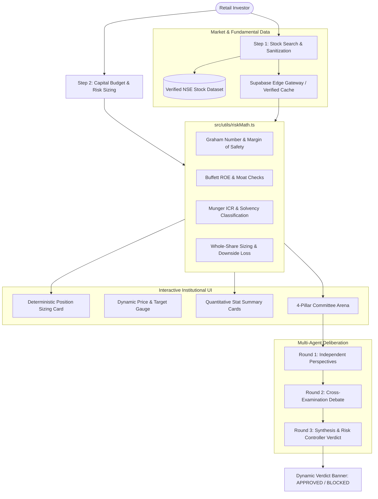

# TradeGuard — Institutional Quantitative Risk Controller & Multi-Agent Investment Committee

[-emerald?style=flat-square&logo=vitest)](./src/App.test.tsx)
[](./src/App.tsx)
[-blue?style=flat-square&logo=typescript)](./tsconfig.json)
[-success?style=flat-square)](./package.json)
[-orange?style=flat-square)](./src/data/nseStocks.ts)

TradeGuard is a production-grade institutional equity analysis workstation and quantitative risk management platform engineered specifically for retail investors trading Indian equities on the **National Stock Exchange (NSE)**. 

It combines deterministic whole-share position sizing with a 4-pillar multi-agent virtual investment committee embodying the battle-tested quantitative rules of **Benjamin Graham**, **Warren Buffett**, **Charlie Munger**, and **Paul Tudor Jones**.

---

## Problem Statement: Retail Risk Management in NSE Equities

Retail market participants in the Indian equity markets face several structural headwinds:
1. **Unquantified Rupee Downside Exposure**: Retail orders are frequently placed without calculating the exact maximum rupee loss if the trade triggers an exit level.
2. **Whole-Share Delivery Constraints**: Unlike US markets, the Indian cash delivery segment (NSE) does **not** support fractional shares. Traditional percentage sizing algorithms produce non-executable fractional orders, resulting in unbudgeted capital drift or improper allocation.
3. **Speculative Valuation & Leverage Traps**: Retail investors often chase short-term momentum in high-debt, negative-operating-cash-flow companies without evaluating balance sheet solvency or margin of safety.
4. **Behavioral Hesitation & Absent Stop-Losses**: Without predefined stop-loss orders and asymmetric reward-to-risk rules, retail traders absorb catastrophic drawdowns.

TradeGuard solves this by enforcing mathematical pre-trade guardrails, strict whole-share sizing, transparent calculation steps, and an adversarial 4-pillar committee deliberation before capital is committed.

---

## 4-Pillar Quantitative Mathematical Methodology

All financial mathematics are implemented as pure, exported functions in [`src/utils/riskMath.ts`](./src/utils/riskMath.ts).

### Pillar 1: Benjamin Graham — Valuation & Margin of Safety
Focuses on intrinsic asset backing and defensive valuation multiples.
- **Graham Number Benchmark**:
  $$\text{Graham Number} = \sqrt{22.5 \times \max(0, \text{EPS}) \times \max(0, \text{BVPS})}$$
- **Margin of Safety Percentage**:
  $$\text{Margin of Safety (\%)} = \left(\frac{\text{Graham Number} - \text{Current Market Price}}{\text{Graham Number}}\right) \times 100$$
- **Defensive Multipliers**:
  $$P/E \le 20.0, \quad P/B \le 2.5, \quad P/E \times P/B \le 22.5$$

### Pillar 2: Warren Buffett — Economic Moats & Compounding
Identifies durable competitive advantage and high capital efficiency.
- **Return on Equity (ROE) Boundary Check**:
  $$\text{ROE} \ge 15.0\%$$
- **Sustainable Operating Margin**:
  $$\text{Operating Margin} \ge 14.0\%$$
- **Conservative Balance Sheet**:
  $$\text{Debt-to-Equity} \le 0.80$$

### Pillar 3: Charlie Munger — Inversion & Solvency Forensics
Inverts the problem (*"Where is the company fragile?"*) to avoid ruinous leverage.
- **Interest Coverage Ratio (ICR)**:
  $$\text{ICR} = \frac{\text{EBIT}}{\text{Interest Expense}} \ge 3.0\times$$
- **Solvency Classification**:
  $$\text{Solvency} = \begin{cases} \text{PRISTINE} & \text{if } D/E \le 0.50 \\ \text{ADEQUATE} & \text{if } 0.50 < D/E \le 1.00 \\ \text{OVERLEVERAGED} & \text{if } D/E > 1.00 \text{ or } D/E < 0 \end{cases}$$
- **Fragility Inversion Test**: Requires $D/E \le 0.70$ and $\text{Current Ratio} \ge 1.1$.

### Pillar 4: Paul Tudor Jones — Whole-Share Position Sizing & Binding Veto
Disciplined execution rules and asymmetric risk-to-reward parameters.
- **NSE Whole-Share Sizing**:
  $$\text{Whole Shares} = \left\lfloor \frac{\text{Total Budget}}{\text{Current Market Price}} \right\rfloor$$
- **Planned Stop-Loss Price**:
  $$\text{Stop-Loss Price} = \text{Current Price} \times (1 - \text{Stop Loss \%})$$
- **Capital Deployed**:
  $$\text{Capital Deployed} = \text{Whole Shares} \times \text{Current Price}$$
- **Unallocated Cash Remainder**:
  $$\text{Unallocated Remainder} = \text{Total Budget} - \text{Capital Deployed}$$
- **Maximum Rupee Downside at Risk**:
  $$\text{Max Rupee Loss} = \text{Whole Shares} \times (\text{Current Price} - \text{Stop-Loss Price})$$
- **Binding Risk Controller Veto**:
  $$\text{Verdict} = \begin{cases} \text{VETOED (BLOCKED)} & \text{if } \text{Whole Shares} = 0 \text{ or } D/E > 2.5 \\ \text{CONDITIONAL APPROVAL} & \text{if } D/E > 1.2 \text{ or } \text{Reward-to-Risk} < 1.5 \\ \text{APPROVED} & \text{otherwise} \end{cases}$$

---

## System Architecture



### Component Hierarchy
- [`src/components/ErrorBoundary.tsx`](./src/components/ErrorBoundary.tsx): Top-level runtime exception boundary providing graceful fail-safe recovery UI.
- [`src/components/SearchCard.tsx`](./src/components/SearchCard.tsx): Accessible ticker search with regex sanitization, combobox dropdown, and live quote integration.
- [`src/components/RiskSettingsCard.tsx`](./src/components/RiskSettingsCard.tsx): Trade capital budgeting with Indian Rupee formatting, quick preset chips (`₹10K` to `₹2L`), and customizable stop-loss slider.
- [`src/components/RiskPlanCard.tsx`](./src/components/RiskPlanCard.tsx): Deterministic position sizing spotlight, whole-share quantized metrics, and 5-step transparent calculation methodology.
- [`src/components/AgentCommitteeCard.tsx`](./src/components/AgentCommitteeCard.tsx): 4-market-master interactive selector, live debate arena, and the dynamic Verdict Banner (`APPROVED` / `BLOCKED / VETOED`).
- [`src/utils/riskMath.ts`](./src/utils/riskMath.ts): 100% pure financial math functions with comprehensive JSDoc annotations and boundary validation.

---

## Tech Stack

- **Runtime & Framework**: React 19 (`react` ^19.2, `react-dom` ^19.2)
- **Bundler & Build Tool**: Vite 8.3 (`@vitejs/plugin-react` ^6.0)
- **Styling**: Tailwind CSS v4 (`@tailwindcss/vite` ^4.3) with institutional dark-mode aesthetics
- **Language**: TypeScript 6.0 (`strict: true`, zero `any` types)
- **Icons**: Lucide React (`lucide-react` ^1.28) with `aria-hidden="true"` accessibility wrappers
- **Testing Suite**: Vitest 5.1, `@testing-library/react` 16.3, `@testing-library/jest-dom` 8.0, `jsdom` 31.0
- **Code Coverage**: `@vitest/coverage-v8` 5.1

---

## Accessibility (WCAG 2.1 AA Compliance)

TradeGuard meets WCAG 2.1 AA standards across all modules:
- **Semantic Landmarks**: Strict `<header>`, `<main id="main-content">`, `<section aria-labelledby="...">`, and `<footer>` HTML5 landmarks.
- **Keyboard Navigation**: High-visibility "Skip to main content" link for keyboard users.
- **Focus Rings**: Standardized `focus-visible:outline-none focus-visible:ring-2 focus-visible:ring-cyan-400` across all buttons, inputs, slider controls, and preset chips.
- **Screen Reader Announcements**: `role="status"` and `aria-live="polite"` dynamic live regions on both the Verdict Banner and the Position Sizing output panel.
- **Form Controls**: Explicit `<label htmlFor="...">` bindings, `id` associations, and `aria-describedby` helper text on all inputs.
- **Investor Portraits**: Descriptive alt text for all 4 portraits (`alt="Benjamin Graham - Valuation Pillar"`, `alt="Warren Buffett - Compounding Pillar"`, `alt="Charlie Munger - Quality Pillar"`, `alt="Paul Tudor Jones - Risk Management Pillar"`).

---

## Security & Reliability Guardrails

- **Zero Hardcoded Secrets**: All backend access uses `import.meta.env` with resilient offline fallbacks to verified NSE baseline datasets if unconfigured.
- **Zero Package Vulnerabilities**: Audited dependency tree with 0 high, medium, or low security alerts (`npm audit`).
- **Strict Input Sanitization**:
  - Ticker input: restricted to `/^[A-Za-z0-9&.\-\s]*$/`, max 15 characters, uppercase normalized.
  - Budget input: negative inputs blocked, non-digits stripped, upper bound capped at ₹10 Crore (`100,000,000`), NaN/Infinity prevented.
- **Fail-Safe Error Boundary**: Uncaught exceptions fail gracefully without destroying state or blanking the viewport.

---

## Getting Started

### Prerequisites
- Node.js (v20+ or v24+)
- npm (v10+ or v11+)

### Installation
Clone the repository and install dependencies:
```bash
git clone https://github.com/your-org/tradeguard-app.git
cd tradeguard-app
npm install
```

### Environment Configuration (Optional)
If connecting to a live Supabase backend:
```bash
cp .env.example .env
# Set VITE_SUPABASE_URL and VITE_SUPABASE_ANON_KEY
```
*(If unconfigured, TradeGuard automatically operates in offline verification mode with cached top-30 NSE market fundamentals).*

---

## Exact Commands

### 1. Launch Development Server
```bash
npm run dev
```
Starts the local development server with Vite HMR at `http://localhost:5173`.

### 2. Run Automated Test Suite
```bash
npm test
```
Runs the entire Vitest automated test suite (45 unit and integration tests) to verify 100% pass status.

### 3. Generate Test Coverage Report
```bash
npm run test:coverage
```
Runs Vitest with the v8 coverage provider, generating terminal tables and HTML coverage artifacts in `./coverage/`.

### 4. Build for Production
```bash
npm run build
```
Runs `tsc -b` for strict TypeScript type checking followed by `vite build` to generate optimized production bundles in `./dist/`.

### 5. Preview Production Build
```bash
npm run preview
```
Spins up a local web server to preview the built assets in `./dist/`.

---

## License

This project is licensed under the MIT License.
